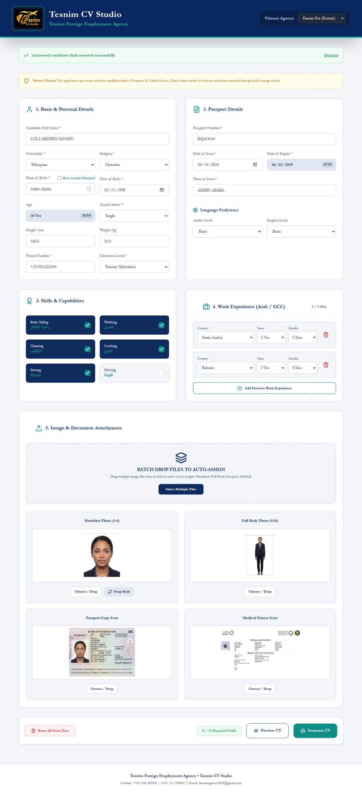
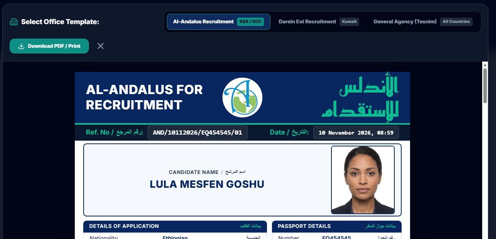
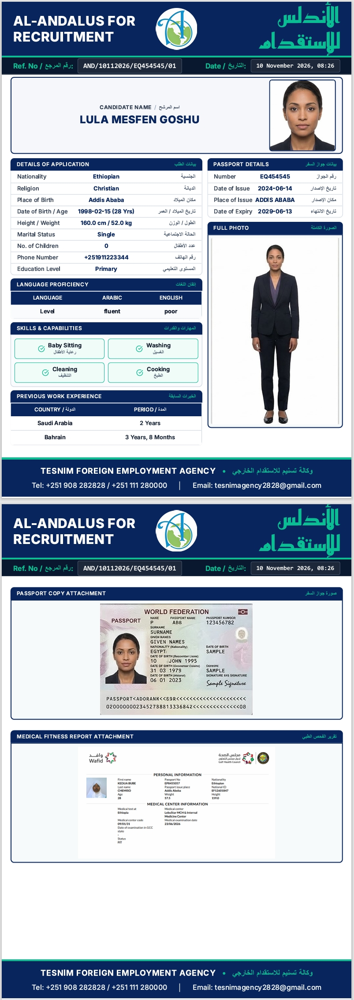
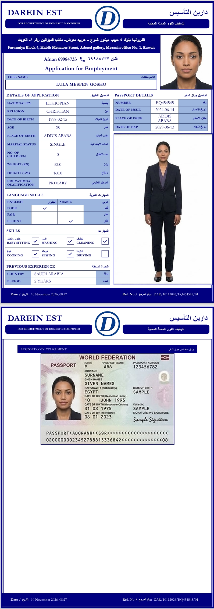

# Tesnim CV Studio

A bilingual candidate registration and CV generation application developed for **Tesnim Foreign Employment Agency**.

## Overview

Tesnim CV Studio streamlines candidate registration, document management, CV previews, and printable PDF generation for domestic manpower recruitment operations.

## Key Features

- Candidate registration and personal information management.
- Automatic age calculation and passport expiry detection.
- English and Arabic language proficiency.
- Domestic work skills and previous GCC employment records.
- Candidate photo, passport, and medical document attachments.
- Three office templates: Al-Andalus, Darein Est, and General Agency.
- CV preview and printable PDF generation.
- Browser-based draft restoration and autosave.

## Technology Stack

- React 19
- TypeScript 6
- Vite 8
- Tailwind CSS 3
- Framer Motion
- Lucide React
- jsPDF
- html2pdf.js
- html2canvas
- @react-pdf/renderer

## Getting Started

### Requirements
- Node.js
- npm
- Git

### Installation

```bash
git clone https://github.com/amir-susa/domestic-recruitment-cv.git
cd domestic-recruitment-cv
npm install
```

### Development

```bash
npm run dev
```

### Production Build

```bash
npm run build
```

### Preview Production Build

```bash
npm run preview
```

### Lint

```bash
npm run lint
```

## Project Structure

```text
src/
├── assets/
├── components/
├── config/
├── context/
├── data/
├── pdf/
├── App.tsx
├── main.tsx
└── index.css
```

## Privacy and Data Protection

Candidate information may include sensitive personal details, passport information, photographs, and medical documents.

- Do not commit real candidate documents or identifiable applicant photographs.
- Use authorized and secure devices.
- Clear saved candidate drafts when using shared devices.
- Restrict access to generated CVs and supporting documents.

Browser-based data handling does not replace organizational access controls or appropriate data-retention policies.

## Intended Use

An internal recruitment documentation tool for candidate registration, CV preparation, and printable document generation.

---

**Developed for Tesnim Foreign Employment Agency.**

## Application Screenshots

### 1. Main Application
The candidate registration interface for entering personal information, passport details, language proficiency, skills, and work experience.



### 2. CV Preview
Preview the completed candidate CV before generating the final document.



### 3. Saudi Recruitment CV
Printable CV layout for Saudi Arabia recruitment operations.



### 4. Kuwait Recruitment CV
Printable Darein Est CV layout for Kuwait recruitment operations.



